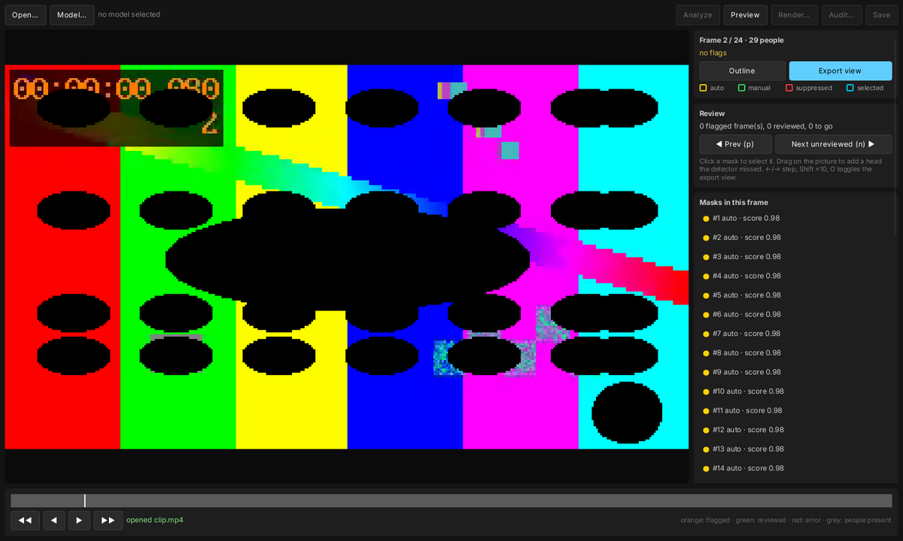

# reco-anonymize

[](https://github.com/wendibus/reco-anonymize/actions/workflows/ci.yml)
[](LICENSE)

Opaque head anonymization for reco panorama videos (and any other footage), 100 % local.
Every detected human head is covered with a solid fill; resolution, timestamps (VFR included),
colour description, rotation and all audio streams stay as they were. Container metadata (GPS,
title, device) is stripped.

Built to match the [reco](https://github.com/reco-project/video-stitcher) architecture: Rust
workspace, `ffmpeg-next` 8, ONNX Runtime sessions created by `reco-detect` (CoreML on macOS),
AGPL-3.0-only.

> Automatic detection is never 100 % reliable. The tool enforces a human review step before
> any final export, and fails closed everywhere else (see `docs/SPEC.md` §8, §13).

## Download

Get the package for your system from the **[latest release](https://github.com/wendibus/reco-anonymize/releases/latest)**
and check it against `SHA256SUMS.txt`:

| Platform | File | Contents |
|---|---|---|
| Linux x86_64 | `reco-anonymize-<version>-linux-x86_64.tar.gz` | `reco-anon`, `reco-anon-review`, FFmpeg libraries in `lib/` |
| Windows x86_64 | `reco-anonymize-<version>-windows-x86_64.zip` | `.exe` files and FFmpeg DLLs |
| macOS (Apple silicon) | `reco-anonymize-<version>-macos-arm64.tar.gz` | binaries, FFmpeg dylibs in `lib/`, CoreML acceleration |

Unpack and start `reco-anon-review` (the app) or use `reco-anon` (command line). The binaries
are not notarized/signed by a certificate yet: on macOS allow them under *System Settings →
Privacy & Security*, on Windows confirm the SmartScreen prompt.

**Updates:** the app checks GitHub for a newer release at start (*App → Check for updates at
start*, on by default) and offers *Install update*; `reco-anon update` does the same on the
command line. That check is the only network request the tool makes on its own; no footage or
paths are sent. Updates are installed only if their SHA-256 matches `SHA256SUMS.txt`.

**Languages:** the app is available in English, German, French and Spanish (system language by
default, *App → Language* to change). The command line is English.

## Workflow

```sh
reco-anon analyze game.mp4 --model models/rfdetr-seg-medium.onnx   # -> game.mp4.anon/
reco-anon status  game.mp4                                          # flagged frames
reco-anon zone add game.mp4 --label stands --points "0,0 5760,0 5760,380 0,420"
reco-anon render  game.mp4 --preview                                # game.mp4.anon/preview.mp4
reco-anon approve game.mp4 --i-reviewed-the-preview
reco-anon render  game.mp4 -o game-anon.mp4                         # gated, verified
reco-anon audit   game.mp4 -o game-anon.mp4 --model models/rfdetr-seg-medium.onnx
reco-anon status  game.mp4                                          # export CLEAN?
```

- Long analyses checkpoint every 250 frames; after a crash continue with `analyze … --resume`.
- Progress shows the frame rate and the estimated time left.
- Speed: every tile is also run mirrored by default (`--no-flip` halves the work). For a camera
  looking down a field, `--coarse-below 0.45` tiles the lower part of the frame, where people
  are near and large, with tiles twice the size (*Near camera from* in the app); distant
  people above keep native-resolution tiles. `--detect-interval-ms 67` runs the detector only
  every 67 ms (every 2nd frame at 30 fps, every 4th at 60 fps) and lets the tracker fill the
  frames in between (*every 67 ms* in the app). The masks are extended by `--dilation-ms`
  (default 100) before and after every track; the interval may be at most that plus one frame.
  Both are converted to frames with the clip's frame rate, so a setting means the same at
  25, 30 or 60 fps.

  Measured on a 4096×1152 soccer panorama (M4 Pro, seg-medium, 30 frames), coverage = share of
  the confident heads (score ≥ 0.5) of a full analysis that end up ≥ 95 % masked in the render:

  | settings | s/frame | coverage |
  |---|---|---|
  | defaults | 4.8 | 100 % (reference) |
  | `--coarse-below 0.45` | 2.6 | 99.7 % |
  | `--coarse-below 0.45 --detect-interval-ms 67` (recommended for panoramas) | 1.3 | 99.1 % |
  | `--coarse-below 0.45 --no-flip --detect-interval-ms 67` | 0.7 | 96.9 % |

  On macOS the model runs through CoreML in the MLProgram format on the GPU; versions before
  0.6 used the NeuralNetwork format, which was about 9× slower (39 s/frame on that clip).
- `audit` re-runs detection on the rendered file and checks from the output pixels that every
  head it finds is covered. Hits must be fixed or acknowledged with a reason (`audit-ack`)
  before `status` reports the export as clean. A new render voids the previous audit.

- `render` refuses without a valid approval. Any change to tracks or zones voids it.
- Frames that were not analysed, errored, or whose timestamp differs at render time are painted
  fully opaque.
- The output is verified by decoding it (frame count and timing) before it gets its final name.
- `approve` refuses a clip in which nobody was detected (likely wrong model or class index)
  unless `--no-people-expected` is given.

## Review app



```sh
cargo run --release -p anon-gui -- game.mp4      # or: reco-anon-review game.mp4.anon
```

Same workflow without the command line: open a video, choose the model, Analyze, then step
through the flagged frames (`n` jumps to the next unreviewed one, the timeline shows what is
left). Outline view shows every mask; Export view shows exactly what the export will contain.

- Click a mask to select it. Suppress false positives (a reason is required), restore them.
- Drag on the picture to add a head the detector missed. With a manual track selected, a box on
  another frame adds a keyframe; frames in between are interpolated.
- Draw zones (stands, scoreboard): click the corners, label, optional frame range. Zones are
  always masked.
- Approve unlocks only after every flagged frame has been shown. Render asks for the output path
  and audits the export right away.

## Training data for a head detector

```sh
reco-anon export-dataset game1.mp4 game2.mp4 --out head-dataset
```

Writes reviewed head labels in COCO format (`train/`, `valid/`, `test/` with
`_annotations.coco.json`, category `head`), the layout RF-DETR and Reco Trainer use. Only
approved projects are exported (`--allow-unreviewed` overrides); suppressed false positives are
left out, manual heads are included. Splits use whole 300-frame blocks so near-identical frames
never land in both train and test. **The dataset contains un-anonymized frames; keep it local.**
In the app: *App → Export training data…*.

## Jersey numbers (optional)

```sh
python scripts/fetch_ppocr.py --version v5 --out models/ppocr-det-v5.onnx
reco-anon analyze game.mp4 --model models/rfdetr-seg-medium.onnx --text-model models/ppocr-det-v5.onnx
```

A PaddleOCR DB text detector (Apache-2.0) runs inside every person box; text regions are
tracked like heads and masked. In the review app: *Text model…* and the *Jersey numbers* box.
Names on the scoreboard are handled with a zone.

## Model

RF-DETR-Seg (Apache-2.0 code and COCO weights). Export once on the Mac:

```sh
python3 -m venv .venv && . .venv/bin/activate
pip install "rfdetr>=1.3" onnx onnxsim
python scripts/export_rfdetr.py --size medium --out models/rfdetr-seg-medium.onnx
```

This writes `models/rfdetr-seg-medium.onnx.json` (sha256, licence, person class). `analyze`
refuses models whose hash does not match their manifest. Only the Apache sizes (nano … large)
are allowed; XL/2XL use a different licence.

`--task det` exports a detection-only model (boxes, no masks; heads are then taken from the top
of the person box). It is 2–4× faster, but on the clip above only about 75 % of the heads were
fully covered, so it is not recommended until a dedicated head detector is trained (see
*Training data for a head detector*).

## Build

```sh
brew install ffmpeg pkg-config
cargo build --release -p anon-cli      # binary: target/release/reco-anon (CoreML EP on macOS)
cargo test --workspace
```

On machines where the ONNX Runtime binaries cannot be downloaded at build time, build with
`--features anon-cli/load-dynamic` and point `ORT_DYLIB_PATH` at a `libonnxruntime` 1.24.

## Layout

| crate | role |
|---|---|
| `anon-model` | project files, tracks, zones, frame table, approval hash, mask resolver |
| `anon-detect` | tiling, flip + full-frame passes, fusion, head derivation, RF-DETR backend |
| `anon-track` | bidirectional Kalman/ByteTrack tracker, gap bridging, extrapolation, motion padding |
| `anon-render` | conservative span rasterizer, opaque fill in planar YUV (8/10-bit, 4:2:0/4:2:2/4:4:4) |
| `anon-io` | probe, fingerprint, decode, VFR-safe re-encode, audio stream copy, metadata strip |
| `anon-pipeline` | analyze (resumable), flags, review gate, render, verification, audit |
| `anon-review` | headless review session: frame seeking, overlays, edits, approval readiness |
| `anon-update` | release check and SHA-256-verified self-update |
| `anon-cli` | `reco-anon` |
| `anon-gui` | `reco-anon-review` (Slint) |

Milestones and design: [`docs/SPEC.md`](docs/SPEC.md).
